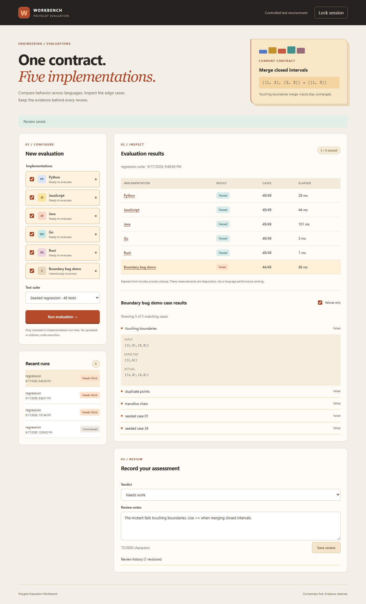

# Polyglot Evaluation Workbench

Compare five implementations of the same contract, inspect the evidence behind a failure, and keep a review history alongside the results.

The application joins a React/TypeScript interface, a Node.js gateway, a Python API, SQLite persistence, and workers written in Python, JavaScript, Java, Go, and Rust. The first contract merges closed intervals. A deliberately incorrect JavaScript implementation is included so you can check that the evaluator catches a real boundary bug.



## What you can do

- Run boundary fixtures, a reproducible regression suite, or your own interval input.
- Compare expected and actual results without rerunning the evaluation.
- Inspect failed cases, worker errors, missing runtimes, and timeouts separately.
- Save an assessment, revisit older runs, and inspect review revisions.
- Share read-only access without granting evaluation or review permissions.
- Back up the database consistently and verify restoration.

This is a portfolio application for a controlled environment. It runs only checked-in implementations. It does not accept arbitrary code, call an AI model, or provide public multi-tenant hosting. [Architecture and limits](docs/architecture.md) explains the tradeoffs.

## Run with Docker

Install Docker with Compose, then generate a local token and start the application.

**PowerShell**

```powershell
$env:WORKBENCH_TOKEN = [guid]::NewGuid().ToString('N') + [guid]::NewGuid().ToString('N')
docker compose up --build -d
$env:WORKBENCH_TOKEN
```

**Bash**

```bash
export WORKBENCH_TOKEN="$(openssl rand -hex 32)"
docker compose up --build -d
printf '%s\n' "$WORKBENCH_TOKEN"
```

Open [localhost:4173](http://localhost:4173) and paste the generated token. Display it only on your local terminal; do not put it in screenshots, commits, tickets, or shared logs. The build runs frontend, gateway, Python, Java, Go, and Rust tests before producing the image. The first build downloads the language toolchains and can take several minutes.

Data lives in the `workbench-data` Docker volume. `docker compose down` stops the application and preserves it. Do not add `--volumes` unless you intend to delete the saved results.

To enable read-only access, set a separate random `READ_ONLY_TOKEN` and add it to the service's environment. The [API reference](docs/api.md) documents the permissions. Tokens are kept only in browser memory; refreshing the page locks the workspace.

## Try the failure workflow

1. Unlock the workspace and keep the five available language implementations selected.
2. Add **Boundary bug demo** and choose **Seeded regression**.
3. Run the evaluation. The five correct implementations should pass all 49 cases; the demo should fail.
4. Select the demo, filter to failures, and expand **touching boundaries**.
5. Compare the expected merged interval with the actual separate intervals.
6. Save a **Needs work** review with the reason. Refresh, unlock, and reopen the run to verify persistence.

The elapsed times include runtime startup. They are useful for debugging this application, not for ranking language performance.

## Develop without Docker

Use Node.js 24, Python 3.11 or newer, Java 17, Go 1.25, and Rust 1.91 or newer. Python has no third-party runtime dependencies.

```bash
npm ci
python scripts/build_workers.py --strict
npm run build
npm start
```

On systems where Python is named `python3`, use that command and set `PYTHON=python3` if needed. On Windows, set `$env:PYTHON` to the real Python executable when the system alias points to the Microsoft Store. The launcher prints a generated local token if none was provided.

For quick frontend work, rebuild with `npm run build` and refresh the browser. There is deliberately one browser origin in the standard workflow; you do not need a CORS bypass or a separate frontend credential store. The build-worker script reports missing compilers; without `--strict`, available workers can still be used, while missing ones stay disabled in the UI.

## Verify a change

```bash
npm run build
npm test
python -m unittest discover -s backend/tests -v
npm run format:check
docker build -t workbench:verify .
```

For browser checks, start that image with the test tokens described in [testing.md](docs/testing.md), install Chromium with `npx playwright install chromium`, and run `npm run test:e2e`. CI repeats the build and browser workflow from a clean checkout, including all five runtimes.

## Repository map

| Path                           | Contents                                                    |
| ------------------------------ | ----------------------------------------------------------- |
| `frontend/src/components`      | Forms, history, evidence inspection, review UI              |
| `frontend/src/useWorkbench.ts` | Browser state and request lifecycle                         |
| `gateway`                      | Same-origin gateway and request protections                 |
| `backend`                      | Domain rules, execution, HTTP API, database operations      |
| `workers`                      | Equivalent implementations and native tests                 |
| `scripts`                      | Local launcher, compiler helper, consistent database backup |
| `deploy`                       | AWS host service configuration and operational scripts      |
| `tests/e2e`                    | Real-browser workflow and accessibility checks              |
| `.github/workflows`            | Build, test, formatting, and dependency checks              |

## Documentation

- [Architecture and design decisions](docs/architecture.md)
- [API contract and error handling](docs/api.md)
- [Test strategy and reproduction](docs/testing.md)
- [Security boundaries](docs/security.md)
- [AWS deployment guide](docs/aws-deployment.md)
- [Operations and recovery](docs/operations.md)
- [Learning walkthrough and honest résumé wording](docs/learning.md)

AWS deployment is documented but has not been performed as part of this repository's local verification. Review the account, region, access model, cost, and acceptance checks before provisioning resources.
