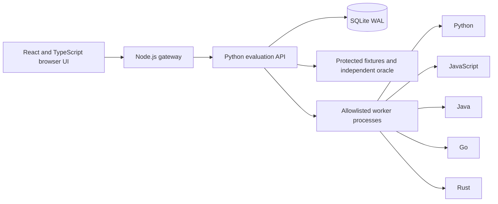

# Architecture

The workbench compares a small, fixed set of implementations against an independent oracle. It records enough evidence to explain a result after the process has finished: input, expected output, actual output, elapsed time, and review history.

## Request path

The gateway serves the built frontend and proxies a fixed set of API routes. The browser never talks directly to the Python port. Both processes run in one container; the Python service binds to loopback. Only the gateway is exposed.

## Responsibilities

| Component             | Responsibility                                                                 | Boundary                                                         |
| --------------------- | ------------------------------------------------------------------------------ | ---------------------------------------------------------------- |
| React components      | Forms, result inspection, pagination, review history, responsive layout        | No secrets persisted in browser storage                          |
| TypeScript state hook | Session state, API calls, pending/error states, selected run                   | Server remains authoritative for validation and permissions      |
| JavaScript gateway    | Static assets, route allowlist, origin checks, body limits, request throttling | No arbitrary upstream URL or command accepted                    |
| Python API            | Access control, validation, fixture selection, orchestration, persistence      | Two evaluations at a time; bounded input                         |
| SQLite                | Saved results, optimistic review versions, review revisions                    | One application instance on a local disk                         |
| Workers               | Equivalent sort-and-merge implementations                                      | Fixed executables, structured stdin/stdout, five-second deadline |

## Why these choices

**One deployable container.** The gateway/API boundary demonstrates HTTP integration without turning each algorithm implementation into a network service. Per-language microservices would add deployment and failure modes without a useful product benefit here.

**Independent oracle.** Workers use a sort-and-sweep algorithm. The Python oracle repeatedly joins overlapping connected components. Using a different algorithm makes it less likely that a shared implementation mistake passes every language. Golden boundary fixtures and an intentionally incorrect JavaScript variant test the evaluator itself. This is strong evidence for the covered contract, not a proof for every possible input.

**Batched worker protocol.** A suite is sent to each process in one batch. There is one line per case, and one JSON output line per case. A mismatch in output count is an execution error. Process startup is included in elapsed time, so the UI explicitly avoids presenting the numbers as a language speed ranking.

**SQLite WAL.** A single instance does not need a separate database server. WAL permits reads during writes, each operation opens and closes its own connection, and SQL parameters keep user input out of query syntax. Move to PostgreSQL and a durable job queue before horizontal scaling. Do not place this SQLite database on EFS or another network filesystem.

**Optimistic review updates.** Every review request carries the version displayed to the reviewer. An update only succeeds if that version still matches. The latest assessment and its historical revision are written in one transaction. A stale request returns a conflict instead of silently overwriting another review. History is useful operational evidence, but it is not a tamper-proof compliance audit log and shared tokens do not identify individual people.

**Synchronous bounded evaluation.** Runs are short and deterministic, so an asynchronous queue is not necessary for this version. The server allows two concurrent runs. Other submissions get a retryable response. A process crash during evaluation loses that in-flight run; completed runs remain stored. Long-running jobs need a durable queue and explicit job states.

## Data model

`runs` stores the immutable evaluation payload, current review verdict and note, creation time, and review version. `reviews` stores historical review revisions, keyed by run and version. The recent-runs API returns the latest 50 records without their case arrays; run details return the evidence and up to 50 review revisions.

The startup migration adds the review version column to databases created before review history existed. Further schema changes should use explicit numbered migrations and a tested rollback plan. There is no automatic data deletion in this version.

## Failure behavior

| Condition                            | Behavior                                                        |
| ------------------------------------ | --------------------------------------------------------------- |
| Incorrect result                     | The run is saved with a failed case and expected/actual values  |
| Missing compiler artifact or runtime | Implementation is unavailable, never marked passed              |
| Worker timeout                       | Worker is killed and marked timeout                             |
| Invalid worker output                | Implementation is marked error                                  |
| Bad input                            | Request rejected before any worker starts                       |
| Missing or wrong token               | Unauthorized response                                           |
| Viewer tries to write                | Forbidden response                                              |
| Stale review                         | Conflict; reopen the saved run and reconcile changes            |
| Too many requests or evaluations     | Retryable rate/capacity response                                |
| API unavailable                      | Gateway returns an unavailable response; browser shows an error |

## Scope

This is a complete portfolio application for one evaluation contract. It is suitable for a controlled single-operator or small trusted-team trial. It is not a public multi-tenant execution service, an arbitrary-code sandbox, or a replacement for a production identity platform. AWS rollout and operational acceptance remain separate work.
